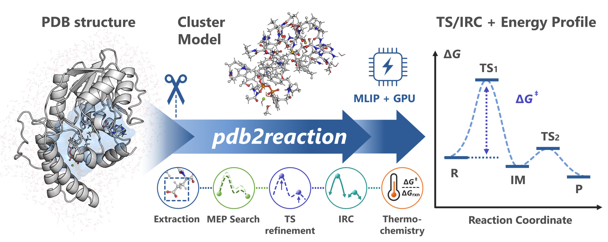

# Getting Started

::::{container} p2r-intro


:::{container} p2r-intro-text
`pdb2reaction` is a Python command-line toolkit that uses machine-learning interatomic potentials (MLIPs) to **search automatically for candidate enzyme reaction pathways, starting from PDB / mmCIF structures**.

MLIPs are neural networks trained on DFT (density functional theory) data. They give energies and forces close to DFT accuracy at a much lower cost, so reaction pathway searches run fast.

In many cases, a **single command** like this one gives a first draft of the reaction pathway:

```bash
pdb2reaction -i 1.R.pdb 3.P.pdb -c 'SAM,GPP,MG' -l 'SAM:1,GPP:-3'
```

It also works for small-molecule reactions. Without `-c`, the input structures are computed as they are, and `-q` sets the total charge (see [Small-molecule reactions](small-molecules.md)).

```bash
pdb2reaction -i R.xyz P.xyz -q +1
```
:::
::::

This page follows the steps of studying an enzyme reaction mechanism and explains the basics of computational chemistry and how to use `pdb2reaction` along the way.

> **Examples:** the [`examples/`](https://github.com/t-0hmura/pdb2reaction/tree/main/examples) directory holds the structures used above (`1.R.pdb`, `3.P.pdb`) and a set of workflow scripts (MEP search and scan pipelines) built around the GPP C6-methyltransferase BezA ([Tsutsumi et al., *Angew. Chem. Int. Ed.* 2022, 61, e202111217](https://doi.org/10.1002/anie.202111217)). After [installation](installation.md), get it with `git clone https://github.com/t-0hmura/pdb2reaction && cd pdb2reaction/examples` and run the commands above there.

---

## Overall workflow

An enzyme reaction mechanism is studied in the seven steps below. `pdb2reaction` runs steps 2–6 in a row with one command.

| Step | What you use | In `pdb2reaction` |
| --- | --- | --- |
| 1. Prepare the complex structure | Structure prediction or docking → MD | Outside `pdb2reaction` |
| 2. Cut out the cluster model | `extract` | With `-c` |
| 3. Find the reaction pathway | `scan`, `path-opt`, `path-search` | `scan` with `-s`; the path search in every mode except TS-only mode |
| 4. Optimize the TS and check the imaginary mode | `tsopt` | With `--tsopt` |
| 5. Check that the TS connects R and P | `irc` | With `--tsopt` |
| 6. Compare the energies | `freq`, `dft` | With `--tsopt` plus `--thermo` / `--dft` |
| 7. Make an overall judgment | NAC fraction, minimum and median barriers | Over several snapshots |

This command runs all of steps 2–6:

```bash
pdb2reaction -i 1.R.pdb 3.P.pdb -c 'SAM,GPP,MG' -l 'SAM:1,GPP:-3' --tsopt --thermo --dft
```

Each step also runs on its own as a subcommand ([`extract`](extract.md), [`tsopt`](tsopt.md), [`irc`](irc.md), and so on; see the [subcommand list](index.md#subcommands)).

---

## 1. Prepare the complex structure

Build a structure of the enzyme–substrate complex with structure prediction such as AlphaFold 3, Boltz-2, or OpenFold3, or with a docking tool. Run molecular dynamics (MD) on it and take snapshots of various conformations. Rather than drawing a conclusion from one structure, compute several snapshots.

The structures you give `pdb2reaction` need two things:

### Add hydrogens (required)

Input structures must contain **every hydrogen atom**. When a structure lacks hydrogens (a crystal structure, for example), add them beforehand with a tool such as these:

| Recommended tool | Example command | Notes |
| --- | --- | --- |
| **reduce** (Richardson Lab) | `reduce input.pdb > output.pdb` | Fast; widely used to add hydrogens to crystal structures |
| **Open Babel** | `obabel input.pdb -O output.pdb -h` | General-purpose cheminformatics toolkit |
| **PyMOL** | `h_add` at the command line | Add hydrogens while checking the structure visually |
| **tleap** (AmberTools) | `tleap -f leapin` | Careful placement based on the Amber force field |

`all` fills blank element columns (77–78) by itself; before a standalone command such as `extract`, fill them with [`add-elem-info`](add-elem-info.md). When reading a PDB, every command keeps the {ref}`alternate location (altLoc) with the highest mean occupancy <mmcif-input>` of each residue; [`fix-altloc`](fix-altloc.md) saves that choice to a file.

### Keep the same atom order (multiple structures)

When the input has several structures, such as a reactant (R) and a product (P), **every structure must list the same atoms in the same order** (only the coordinates differ). Run the hydrogen tool on every structure with the same settings. An atom that moves to another residue keeps its residue and atom name from R: in the bundled example, the hydrogen that GPP passes to Glu186 is still `H11` of `GPP 321` in `3.P.pdb`.

mmCIF (`.cif`, `.mmcif`) and large structures (≥10,000 residues or ≥99,999 atoms) work with the same commands as PDB. See {ref}`mmCIF input <mmcif-input>` for details.

---

## 2. Cut out the cluster model

An enzyme has thousands to tens of thousands of atoms, too many to compute as a whole with DFT. Instead, only the substrates and cofactors of the reaction and the residues around them are cut out and computed. This is called a **cluster model**.

- Each cut covalent bond is capped with a hydrogen (a cap hydrogen).
- The atoms that carry the cap hydrogens are frozen, so the model keeps its shape from inside the protein.

`pdb2reaction` builds this model automatically: it selects the residues with an atom within `-r` (default 2.6 Å) of the substrates given with `-c`. Without `-c`, nothing is cut out and the input structure is used as it is. See [Building the cluster model](model-setup.md) for details.

**Model size**: a larger model gives more stable results but costs more. For COMT (catechol *O*-methyltransferase), when the QM region of QM/MM was enlarged outward from the substrate, the activation energy leveled off at about 500–600 atoms ([Kulik et al., *J. Phys. Chem. B* 2016, 120, 11381](https://doi.org/10.1021/acs.jpcb.6b07814)). In the `pdb2reaction` paper, cluster models of the same COMT with `-r 4.0` (670 atoms) or larger gave the same reaction mechanism as the whole system (3,420 atoms), with barriers within 4 kcal/mol of the whole system ([Ohmura et al., *ACS Omega* 2026](https://doi.org/10.1021/acsomega.6c08242)). `pdb2reaction` uses `-r 2.6` by default to keep the cost down. With the default finite-difference Hessian, a GPU with 16 GB of VRAM computes `-r 4.0` models comfortably, so `-r 4.0` is also a good choice. In the bundled BezA example, `-r 2.6` gives a 632-atom model and `-r 4.0` an 859-atom model; one frequency calculation, measured on a GPU with 24 GB of VRAM, peaked at about 5 GB and 7 GB of VRAM and took about 24 and 37 minutes.

---

## 3. Find the reaction pathway

Optimize the reactant (R) and product (P) structures, and search for the minimum energy path (MEP) that connects R and P. The highest-energy point on the path is the candidate for the transition state (TS). This step is the same for small molecules (see [Small-molecule reactions](small-molecules.md)).

There are three ways to give the input:

| Mode | Input | What happens |
| --- | --- | --- |
| **Endpoint mode** | Two or more PDBs (`-i R.pdb P.pdb`) | Extracts the same cluster model from each structure (with `-c`) and searches the MEP between them |
| **Scan-list mode** | One PDB + `--scan-lists` (`-s`) | Changes the chosen bond distances step by step to build the pathway |
| **TS-only mode** | One PDB + `--tsopt` | Skips the MEP search and goes straight to optimizing the TS candidate and running IRC |

> **Note:** a single structure without `--scan-lists/-s` or `--tsopt` stops with an error.

---

## 4. Optimize the TS and check the imaginary mode

A TS is a point where the energy is a maximum along the direction in which the reaction proceeds and a minimum along every other direction (a first-order saddle point). A frequency calculation at this point gives an imaginary frequency (an imaginary mode) for the reaction direction only. If n_imag (the number of imaginary modes) is 0, the point is a minimum; if it is 2 or more, the point is not a TS.

A successful TS optimization gives one imaginary mode along the reaction coordinate. Also check that this mode moves the intended bonds that form and break.

**Frozen atoms and PHVA**: in a cluster model, the energy is neither a minimum nor a saddle point along the directions that move the frozen atoms. A frequency calculation over all atoms can therefore show imaginary modes that come only from the freezing. Instead, the frequencies are taken from the Hessian (the second derivative of the energy) of the movable atoms only. This is called partial Hessian vibrational analysis (PHVA), and `pdb2reaction` runs it automatically when atoms are frozen.

---

## 5. Check that the TS connects R and P

One imaginary mode does not guarantee that the TS lies between the intended R and P. The IRC (intrinsic reaction coordinate) goes downhill from the TS to both sides; check that it ends at the intended R and P. `pdb2reaction` also optimizes both IRC endpoints, so even if the IRC stops partway, the result is usable when the endpoint optimizations reach the intended R and P.

---

## 6. Compare the energies

`--thermo` adds the thermochemical correction (Gibbs free energy) from vibrational analysis, and `--dft` adds DFT single points; with them you get the activation energy (R → TS) and the reaction energy (R → P).

When the run finishes, the output directory (`-o`, default `./result_all/`) contains the following files. [Output Directory Layout](output-layout.md) lists the main files, and {ref}`JSON Output Reference <summary-json-path-search-all>` every key of `summary.json`.

| File / folder | Contents |
| --- | --- |
| `summary.log` | Text summary (directory layout and progress of each stage) |
| `summary.json` | Machine-readable results (barriers, energies of each state, bond changes) |
| `energy_diagram_*.png` | Energy profile plots (electronic energy / Gibbs-corrected) |
| `mep_trj.pdb` / `mep_trj.cif` | Animated trajectory of the minimum energy path (MEP) |
| `segments/seg_NN/` | Detailed results for each reaction segment (optimized R/TS/P structures, IRC trajectories, and more; with `--tsopt`) |

At the end of the terminal output, the `Scientific status:` line under `====== Pipeline summary ======` (`scientific_status` in `summary.json`) is `success` when every requested stage converged and, with `--tsopt`, the TS has n_imag = 1. Otherwise it is `partial` or `failed`, with the reasons in `scientific_status_reasons`. Check yourself that the imaginary mode moves the intended bonds (open the mode file that each quickstart lists) and that the IRC endpoints are the intended R and P (open the endpoint structures that each quickstart lists).

---

## 7. Make an overall judgment

One pathway is not enough for a conclusion. Judge whether the mechanism is plausible by looking together at how often reactive arrangements appear in the MD (near-attack conformations, NACs: the reacting atoms are close and oriented to react) and at the minimum and median barriers over several snapshots.

The results depend strongly on the starting structure and on how the model is built, so trial and error, recomputing with other structures and models, cannot be avoided. `pdb2reaction` automates steps 2–6 and computes them fast with MLIPs, so it suits this trial and error.

---

## Going further

`pdb2reaction` is especially useful for high-throughput calculations over many substrates or mutants, for supporting experimental results, and for trial and error.

MD of the whole system with an MLIP, or ML/MM MD, also shows the dynamics of the whole enzyme. These MD runs cost more than cluster-model or ML/MM calculations on the potential energy surface, so a good approach is to run them after `pdb2reaction` has confirmed the mechanism.

MLIPs are a fairly new technology, so for a purely computational paper, DFT calculations will probably still be expected for a while. `pdb2reaction` also has a DFT backend, so everything up to QM calculations that check an MLIP TS with DFT stays within one tool (see [Refine an MLIP TS with DFT](dft-backend.md)). Give it a try.

---

## Where to start

For environment setup, see the [Installation guide](installation.md).

* **Try it in a web browser**: the [Colab GUI notebook](https://colab.research.google.com/github/t-0hmura/pdb2reaction/blob/main/examples/pdb2reaction_colab.ipynb) (pick residues in a 3D preview)
* **Start from several PDB structures**: [Quickstart: `pdb2reaction all`](quickstart-all.md)
* **Explore from one PDB structure with a scan**: [Quickstart: `pdb2reaction all --scan-lists`](quickstart-scan.md)
* **Optimize and check a TS candidate**: [Quickstart: TS-only mode](quickstart-tsopt.md)

---

## How the command works

Installation provides `pdb2reaction` and the short alias `p2r`. Without a subcommand, `all` runs.

```bash
# These two do the same thing
pdb2reaction [OPTIONS]...
pdb2reaction all [OPTIONS]...
```

---

## Main CLI options

| Option | Example | Description |
| --- | --- | --- |
| `-i, --input` | `1.R.pdb 3.P.pdb` | Input structure files (PDB / mmCIF); accepts several |
| `-c, --center` | `'SAM,GPP'` / `'A:SAM:123'` | Extraction center (substrate residue names, residue IDs, or a PDB file of the substrate with the same coordinates as the input). Without it, no extraction runs and the whole structure is used |
| `-l, --ligand-charge` | `'SAM:1,GPP:-3'` | Formal charge of each ligand, as a mapping (standard residues and ions are counted automatically) |
| `-q, --charge` | `-2` | Total charge of the whole extracted model (set it to override the automatic value) |
| `-m, --multiplicity` | `1` | Spin multiplicity (default `1`, a singlet) |
| `--tsopt/--no-tsopt` | (flag) | Turns on TS optimization and IRC |
| `--thermo/--no-thermo` | (flag) | Runs vibrational analysis and thermochemical correction with the QRRHO (quasi-rigid-rotor harmonic oscillator) model (with `--tsopt`) |
| `--dft/--no-dft` | (flag) | Runs DFT single points on the resulting structures (with `--tsopt`) |
| `-b, --backend` | `uma` / `orb` / `mace` | MLIP backend to use (default `uma`) |

`--dft` needs the DFT extra from step 7 of {ref}`Step-by-step installation <step-by-step-installation>`.

For the syntax rules, see [Common options and selectors](cli-conventions.md); for every option, see the [`all` CLI reference](reference/commands/all.md).

---

## AI agent skills

`pdb2reaction` ships instructions for AI agents (Claude Code, Codex, Cursor, and others) in the `skills/` directory. To install them, tell your AI agent:

> Import `https://github.com/t-0hmura/pdb2reaction/tree/main/skills` as skills, and install pdb2reaction by following `pdb2reaction-install`.

If you cloned the GitHub repository, you can give the local `skills/` path instead. Then you can ask, for example:

> Read *the paper*, build a model from the PDB structure *PDB ID*, and study the mechanism of *the reaction step* with the pdb2reaction skills.

The skills define the CLI subcommands, the input/output rules for PDB/mmCIF/XYZ/GJF, backend installation steps, and best practices for HPC parallel runs. Load `skills/` into an agent, and it can run and analyze calculations from plain-language instructions. For where to place the files and the full list of skills, see [`skills/README.md`](https://github.com/t-0hmura/pdb2reaction/blob/main/skills/README.md).

---

## Troubleshooting and support

If an error occurs during a run, see these pages:

* {ref}`Troubleshooting <troubleshooting-quick-table>`: fixes by error symptom, and solutions for installation and environment problems
* [MLIP Backends](backends.md): details on GPU memory and parallel runs; [HPC example](hpc-example.md) for a job script over several GPU nodes

To see every option of a command, use the help options:

```bash
pdb2reaction <subcommand> --help
pdb2reaction all --help-advanced
```

Report unresolved problems and bugs on [GitHub Issues](https://github.com/t-0hmura/pdb2reaction/issues).
