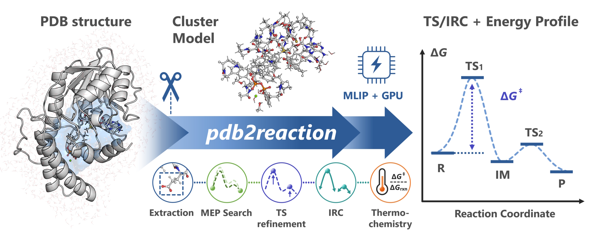

# [pdb2reaction]{.p2r-wordmark} Documentation

:::{container} p2r-hero-meta
[Version: v{{ release }}]{.p2r-pill} [GitHub](https://github.com/t-0hmura/pdb2reaction){.p2r-meta-gh} [ACS Omega paper](https://doi.org/10.1021/acsomega.6c08242){.p2r-meta-paper}
:::

:::{container} p2r-hero


{.p2r-tagline}
**pdb2reaction** is a Python CLI toolkit for analyzing reaction mechanisms in enzyme complexes and small molecules with machine-learning interatomic potentials (MLIPs), starting from **PDB/mmCIF/XYZ/GJF** structures.

{.p2r-lead}
New to pdb2reaction? Start with [Getting Started](getting-started.md).

{.p2r-cta}
[Getting Started](getting-started.md){.p2r-btn .p2r-btn-primary} [Installation](installation.md){.p2r-btn .p2r-btn-install} [Open in Google Colab](https://colab.research.google.com/github/t-0hmura/pdb2reaction/blob/main/examples/pdb2reaction_colab.ipynb){.p2r-btn .p2r-btn-colab}
:::

```{toctree}
:maxdepth: 2
:caption: Introduction
:hidden:

getting-started
installation
```

```{toctree}
:maxdepth: 2
:caption: Quickstart
:hidden:

Endpoint mode <quickstart-all>
Scan-list mode <quickstart-scan>
TS-only mode <quickstart-tsopt>
```

```{toctree}
:maxdepth: 2
:caption: Guides
:hidden:

model-setup
small-molecules
mechanism-tips
dft-backend
troubleshooting
agent-skills
```

```{toctree}
:maxdepth: 2
:caption: Commands
:hidden:

all
fix-altloc
add-elem-info
extract
opt
scan
scan2d
scan3d
path-opt
path-search
tsopt
irc
freq
dft
sp
bond-summary
trj2fig
energy-diagram
```

```{toctree}
:maxdepth: 2
:caption: Reference
:hidden:

cli-conventions
reference/commands/index
yaml-reference
json-output
output-layout
backends
hpc-example
glossary
architecture
```

```{toctree}
:maxdepth: 2
:caption: 導入
:hidden:

ja/getting-started
ja/installation
```

```{toctree}
:maxdepth: 2
:caption: クイックスタート
:hidden:

Endpoint モード <ja/quickstart-all>
Scan-list モード <ja/quickstart-scan>
TS-only モード <ja/quickstart-tsopt>
```

```{toctree}
:maxdepth: 2
:caption: ガイド
:hidden:

ja/model-setup
ja/small-molecules
ja/mechanism-tips
ja/dft-backend
ja/troubleshooting
ja/agent-skills
```

```{toctree}
:maxdepth: 2
:caption: コマンド
:hidden:

ja/all
ja/fix-altloc
ja/add-elem-info
ja/extract
ja/opt
ja/scan
ja/scan2d
ja/scan3d
ja/path-opt
ja/path-search
ja/tsopt
ja/irc
ja/freq
ja/dft
ja/sp
ja/bond-summary
ja/trj2fig
ja/energy-diagram
```

```{toctree}
:maxdepth: 2
:caption: 参照資料
:hidden:

ja/cli-conventions
ja/yaml-reference
ja/json-output
ja/output-layout
ja/backends
ja/hpc-example
ja/glossary
ja/architecture
```

## Quick start

::::{container} p2r-cards
:::{container} p2r-card p2r-card-endpoint
**Analyze the mechanism end to end from the structures before and after the reaction**

<!-- p2r-mode-stages endpoint -->

[Quickstart: all in Endpoint mode](quickstart-all.md)
:::

:::{container} p2r-card p2r-card-scan
**Analyze the mechanism end to end from one structure**

<!-- p2r-mode-stages scan -->

[Quickstart: all in Scan-list mode](quickstart-scan.md)
:::

:::{container} p2r-card p2r-card-tsonly
**Analyze the mechanism end to end from a TS structure**

<!-- p2r-mode-stages tsonly -->

[Quickstart: TS-only mode](quickstart-tsopt.md)
:::
::::

| Goal | Page |
|------|------|
| **Build the cluster model** | [Building the cluster model](model-setup.md) |
| **Analyze reaction mechanisms of small molecules** | [Small-molecule reactions](small-molecules.md) |
| **Analyze reaction mechanisms and search for transition states** | [Tips for studying reaction mechanisms](mechanism-tips.md) |
| **Optimize the MLIP TS structure with DFT** | [Validate the MLIP TS structure with DFT](dft-backend.md) |
| **Investigate why a calculation failed** | [Troubleshooting](troubleshooting.md) |

## Subcommands

<!-- p2r-stage-strip -->

| Subcommand | Description |
|------------|-------------|
| [`all`](all.md) | Takes one of the three [input modes](getting-started.md#3-find-the-reaction-pathway) (Endpoint mode, Scan-list mode, TS-only mode): reactant and product structures, a reactant and a list of reaction coordinates, or a TS candidate structure. Runs model building → MEP search → TS optimization + IRC calculation → thermochemical analysis → DFT single-point calculation in one command. Each stage can be switched on or off. Accepts enzyme complexes and small molecules. |
| [`extract`](extract.md) | Build a cluster model by cutting the active site out of a protein–ligand complex |
| [`opt`](opt.md) | Single-structure geometry optimization (L-BFGS or RFO available) |
| [`tsopt`](tsopt.md) | Transition state (TS) optimization of a single structure (Dimer or RS-P-RFO), giving a structure with one imaginary mode. |
| [`path-opt`](path-opt.md) | Single-step minimum energy path (MEP) optimization by the Growing String method (GSM) or the Direct Max Flux method. Builds the trajectory of the structural change along the reaction from the reactant and product structures. |
| [`path-search`](path-search.md) | Recursive MEP search that automatically detects multistep reactions and builds a multistep minimum energy path. Accepts reactant, intermediate, and product structures. |
| [`scan`](scan.md) | Scan the energy change with distances, angles, or dihedrals as variables (concerted and multistage scans supported) |
| [`scan2d`](scan2d.md) | Two-dimensional energy-landscape exploration and 2D PES mapping |
| [`scan3d`](scan3d.md) | Three-dimensional energy-landscape exploration and 3D PES mapping |
| [`freq`](freq.md) | Vibrational frequency analysis and thermochemical analysis |
| [`irc`](irc.md) | Intrinsic Reaction Coordinate calculation |
| [`dft`](dft.md) | Single-point DFT calculations (GPU4PySCF / PySCF) |
| [`fix-altloc`](fix-altloc.md) | Resolve PDB alternate locations |
| [`add-elem-info`](add-elem-info.md) | Repair PDB element columns (77–78) |
| [`sp`](sp.md) | Single-point calculation with an MLIP (energy + forces / Hessian) |
| [`trj2fig`](trj2fig.md) | Plot energy profiles from XYZ trajectories written by pdb2reaction |
| [`energy-diagram`](energy-diagram.md) | Draw an energy diagram from numeric values |
| [`bond-summary`](bond-summary.md) | Detect and report covalent bond changes between structures of multiple states |

## Configuration and reference

| Topic | Page |
|-------|------|
| **Common options and input requirements** | [Common options and selectors](cli-conventions.md) |
| **Frozen atoms and distance restraints (`--freeze-atoms`, `--distance-restraint`)** | {ref}`Freeze atoms and restrain distances <freeze-atoms-and-restraints>` |
| **Common errors and fixes** | [Troubleshooting](troubleshooting.md) |
| **CLI command reference** | [Command Reference](reference/commands/index.md) |
| **YAML configuration options** | [YAML Reference](yaml-reference.md) |
| **MLIP backend settings** | [MLIP Backends](backends.md) |
| **Details of the files and directories each command writes** | [Output Directory Layout](output-layout.md) |
| **Details of the keys in the JSON result files** | [JSON Output Reference](json-output.md) |
| **Example job scripts for PBS and Slurm** | [HPC example](hpc-example.md) |
| **Let an AI agent use pdb2reaction** | [Agent skills](#agent-skills) |
| **Code structure (for developers)** | [Architecture](architecture.md) |
| **Terminology** | [Glossary](glossary.md) |

## System requirements

- **OS:** Linux (WSL2/Docker recommended on Windows/Mac).
- **Python:** 3.12 (recommended) or 3.13. ORB requires 3.12.
- **PyTorch:** CUDA (recommended) or CPU build.
- **GPU:** at least 8 GB of VRAM. CPU execution is also supported but slower. Compatible NVIDIA driver. UMA also requires GCC and the CUDA Toolkit at runtime.
- **RAM / VRAM:** with the default UMA model, a single point needs about 4 GB of VRAM for ~350 atoms, 8 GB for ~850 atoms, and 16 GB for ~1,750 atoms; a Hessian needs about the same. 8 GB of RAM is enough.

See [Installation](installation.md) for setup.

## Agent skills

`pdb2reaction` ships guides for AI agents in `skills/` that describe how to use the tool and the steps of reaction-mechanism analysis.

They cover CLI commands, structure I/O, backend installation, workflows, output analysis, and HPC use.
To install them, tell your AI agent:

> Import `https://github.com/t-0hmura/pdb2reaction/tree/main/skills` as skills, and install pdb2reaction by following `pdb2reaction-install`.

If you cloned the GitHub repository, you can give the local `skills/` path instead. Then you can ask, for example:

> Read *the paper*, build a model from the PDB structure *PDB ID*, and study the mechanism of *the reaction step* with the pdb2reaction skills.

For details, see [Skills for AI Agents](agent-skills.md).

## Citation

If you use pdb2reaction in your research, cite the following paper:

```bibtex
@article{ohmura2026pdb2reaction,
  author  = {Ohmura, Takuto and Sato, Hajime and Terada, Tohru},
  title   = {pdb2reaction: End-to-End Reaction-Path Elucidation from PDB Structures Using Machine-Learning Interatomic Potentials},
  journal = {ACS Omega}, year = {2026}, doi = {10.1021/acsomega.6c08242}
}
```

To cite the software or a specific release, use the Zenodo record:

```bibtex
@software{ohmura2026pdb2reaction_software,
  author       = {Ohmura, Takuto},
  title        = {pdb2reaction},
  year         = {2026},
  version      = {0.8.0},
  url          = {https://github.com/t-0hmura/pdb2reaction},
  license      = {GPL-3.0},
  doi          = {10.5281/zenodo.19197865}
}
```

## License

GNU General Public License v3 (GPL-3.0).

## Getting Help

```bash
# General help
pdb2reaction --help

# Command help
pdb2reaction <subcommand> --help

# Advanced options (internal tuning)
pdb2reaction <subcommand> --help-advanced
```

Report problems and feature requests on [GitHub Issues](https://github.com/t-0hmura/pdb2reaction/issues).
