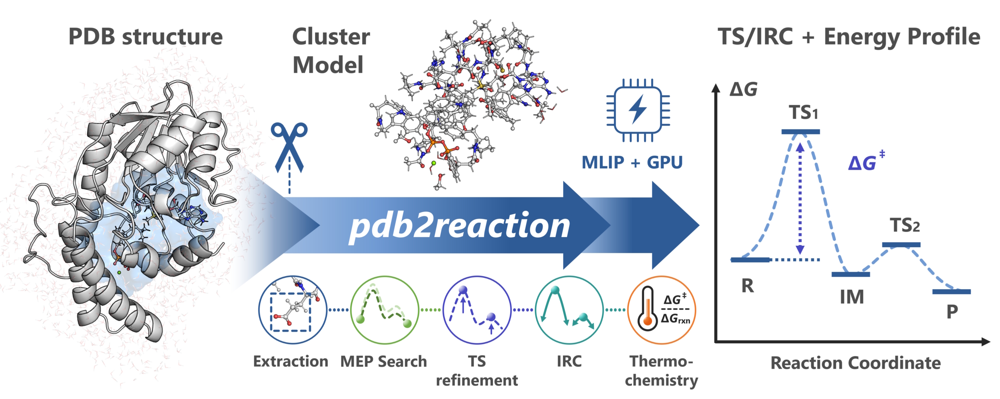

# [pdb2reaction]{.p2r-wordmark} ドキュメント

:::{container} p2r-hero-meta
[バージョン: v{{ release }}]{.p2r-pill} [GitHub](https://github.com/t-0hmura/pdb2reaction){.p2r-meta-gh} [ACS Omega 論文](https://doi.org/10.1021/acsomega.6c08242){.p2r-meta-paper}
:::

:::{container} p2r-hero


{.p2r-tagline}
**pdb2reaction** は、酵素複合体や小分子を対象として、機械学習原子間ポテンシャル（MLIP）を用いて PDB/mmCIF/XYZ/GJF の構造から反応機構を解析するための Python 製 CLI ツールキットです。

{.p2r-lead}
初めての方は [はじめに](getting-started.md) からお読みください。

{.p2r-cta}
[はじめに](getting-started.md){.p2r-btn .p2r-btn-primary} [インストール](installation.md){.p2r-btn .p2r-btn-install} [Google Colab で実行](https://colab.research.google.com/github/t-0hmura/pdb2reaction/blob/main/examples/pdb2reaction_colab.ipynb){.p2r-btn .p2r-btn-colab}
:::

## クイックスタート

::::{container} p2r-cards
:::{container} p2r-card p2r-card-endpoint
**反応の前後の構造から反応機構解析を一気通貫で行う**

<!-- p2r-mode-stages endpoint -->

[クイックスタート: all の Endpoint モード](quickstart-all.md)
:::

:::{container} p2r-card p2r-card-scan
**1 つの構造から一気通貫で反応機構解析を行う**

<!-- p2r-mode-stages scan -->

[クイックスタート: all の Scan-list モード](quickstart-scan.md)
:::

:::{container} p2r-card p2r-card-tsonly
**TS 構造から一気通貫で反応機構解析を行う**

<!-- p2r-mode-stages tsonly -->

[クイックスタート: TS-only モード](quickstart-tsopt.md)
:::
::::

| 目的 | ページ |
|------|------|
| **クラスタモデルを構築する** | [クラスターモデルの組み方](model-setup.md) |
| **小分子についての反応機構解析を行う** | [小分子の反応機構解析](small-molecules.md) |
| **反応機構解析・遷移状態探索を行う** | [反応機構を調べるコツ](mechanism-tips.md) |
| **MLIP で求めた TS 構造を DFT で構造最適化する** | [MLIP での TS 構造を DFT で検証する](dft-backend.md) |
| **計算の失敗原因を調査する** | [トラブルシューティング](troubleshooting.md) |

## サブコマンド

<!-- p2r-stage-strip -->

| サブコマンド | 説明 |
|---------|------|
| [`all`](all.md) | 反応物と生成物構造、反応物と反応座標のリスト、TS 候補構造の、3 つの[入力モード](getting-started.md#3-反応経路を探す)（Endpoint モード・Scan-list モード・TS-only モード）から、モデルの構築 → MEP 探索 → TS 構造最適化 + IRC 計算 → 熱化学解析 → DFT での 1 点計算を 1 コマンドでまとめて実行する。各段階の実行は任意に切り替え可能。酵素複合体・小分子を入力とできる。 |
| [`extract`](extract.md) | タンパク質–リガンド複合体から活性部位を切り出したクラスタモデルを構築 |
| [`opt`](opt.md) | 単一構造の構造最適化（L-BFGS または RFO が利用可能） |
| [`tsopt`](tsopt.md) | 単一構造の遷移状態（TS）構造最適化（Dimer または RS-P-RFO）。虚振動が一つの構造を得る。 |
| [`path-opt`](path-opt.md) | Growing String 法（GSM）または Direct Max Flux 法による 1 段階の最小エネルギー経路（MEP）最適化。反応物と生成物の 2 構造から反応に伴う構造変化のトラジェクトリを構築する。 |
| [`path-search`](path-search.md) | 複数のステップからなる反応を自動検出して多段階の最小エネルギー経路を構築する再帰的 MEP 探索。反応物・中間体・生成物構造を入力できる。 |
| [`scan`](scan.md) | 距離・角度・二面角を変数としてエネルギー変化をスキャン（協奏スキャン・多段階スキャンに対応） |
| [`scan2d`](scan2d.md) | 2 次元のエネルギー地形の探索・2D PES のマッピング |
| [`scan3d`](scan3d.md) | 3 次元のエネルギー地形の探索・3D PES のマッピング |
| [`freq`](freq.md) | 振動数解析と熱化学解析 |
| [`irc`](irc.md) | 固有反応座標（IRC: Intrinsic Reaction Coordinate）計算 |
| [`dft`](dft.md) | DFT 一点計算（GPU4PySCF / PySCF） |
| [`fix-altloc`](fix-altloc.md) | PDB の代替位置を解決 |
| [`add-elem-info`](add-elem-info.md) | PDB の元素欄（77–78 列）を修復 |
| [`sp`](sp.md) | MLIP による一点計算（エネルギー + 力 / Hessian） |
| [`trj2fig`](trj2fig.md) | pdb2reaction が生成する XYZ トラジェクトリからエネルギープロファイルをプロット |
| [`energy-diagram`](energy-diagram.md) | 数値入力からエネルギーダイアグラムを作成 |
| [`bond-summary`](bond-summary.md) | 複数の状態の構造間の共有結合変化を検出・レポート |

## 設定・参照資料

| トピック | ページ |
|-------|------|
| **共通オプションと入力要件** | [共通オプションと残基・原子の指定](cli-conventions.md) |
| **原子の固定と距離の拘束（`--freeze-atoms`・`--distance-restraint`）** | {ref}`原子の固定と距離の拘束 <ja-freeze-atoms-and-restraints>` |
| **よくあるエラーと対処** | [トラブルシューティング](troubleshooting.md) |
| **CLI コマンドの一覧** | [コマンドの一覧](../reference/commands/index.md) |
| **YAML 設定オプション** | [YAML 設定の一覧](yaml-reference.md) |
| **MLIP バックエンド設定** | [MLIP バックエンド](backends.md) |
| **各コマンドが書き出すファイル・ディレクトリの詳細** | [出力ディレクトリのレイアウト](output-layout.md) |
| **結果を報告する JSON の項目詳細** | [JSON 出力の一覧](json-output.md) |
| **PBS・Slurm のジョブスクリプトの例** | [HPC 実行例](hpc-example.md) |
| **AI エージェントに pdb2reaction を使わせる** | [エージェントスキル](#エージェントスキル) |
| **コードの構成（開発者向け）** | [アーキテクチャ](architecture.md) |
| **用語** | [用語集](glossary.md) |

## システム要件

- **OS**: Linux（Windows では WSL2、Mac では Docker を推奨）
- **Python**: 3.12（推奨）または 3.13。ORB は 3.12 が必要です
- **PyTorch**: CUDA 版（推奨）または CPU 版
- **GPU**: VRAM 8 GB 以上。CPU のみでも実行可能ですが低速です。対応する NVIDIA ドライバーが必要で、UMA は実行時に GCC と CUDA Toolkit も必要です
- **RAM / VRAM**: デフォルトの UMA での一点計算は、約 350 原子で VRAM 4 GB、約 850 原子で 8 GB、約 1,750 原子で 16 GB が目安で、Hessian もほぼ同じです。RAM は 8 GB で足ります

セットアップは [インストール](installation.md) を参照してください。

## エージェントスキル

`pdb2reaction` は、ツールの使い方や反応機構解析の手順をまとめた AI エージェント向けの手順書を `skills/` に同梱しています。

次の内容をカバーしています：CLI サブコマンド・構造 I/O・バックエンドインストール・ワークフロー・出力解析・HPC 運用

導入するときは、AI エージェントに次のように指示してください。

> `https://github.com/t-0hmura/pdb2reaction/tree/main/skills` をスキルとして取り込み、`pdb2reaction-install` の手順に従って pdb2reaction をインストールしてください。

GitHub のリポジトリを clone 済みなら、URL の代わりに手元の `skills/` のパスを渡しても構いません。導入後は、たとえば次のように指示できます。

> 〈論文〉を読んで、〈PDB ID〉の構造からモデルを作成し、〈反応段階〉の経路について、pdb2reaction のスキルを用いて反応機構解析を行ってください。

詳しくは [AI エージェント向けスキル](agent-skills.md) を参照してください。

## 引用

`pdb2reaction` を研究で利用する場合は、以下の論文を引用してください:

```bibtex
@article{ohmura2026pdb2reaction,
  author       = {Ohmura, Takuto and Sato, Hajime and Terada, Tohru},
  title        = {pdb2reaction: End-to-End Reaction-Path Elucidation from PDB Structures Using Machine-Learning Interatomic Potentials},
  journal      = {ACS Omega},
  year         = {2026},
  doi          = {10.1021/acsomega.6c08242}
}
```

ソフトウェアまたは特定のリリースを引用する場合は、Zenodo レコードを使用してください:

```bibtex
@software{ohmura2026pdb2reaction_software,
  author       = {Ohmura, Takuto},
  title        = {pdb2reaction},
  year         = {2026},
  version      = {0.7.0},
  url          = {https://github.com/t-0hmura/pdb2reaction},
  license      = {GPL-3.0},
  doi          = {10.5281/zenodo.19197865}
}
```

## ライセンス

`pdb2reaction` は **GNU General Public License version 3 (GPL-3.0)** の下で配布されています。

## ヘルプ

```bash
# 一般的なヘルプ
pdb2reaction --help

# コマンドのヘルプ
pdb2reaction <subcommand> --help

# 詳細オプション（内部チューニング用）
pdb2reaction <subcommand> --help-advanced
```

問題の報告や機能の要望は [GitHub Issues](https://github.com/t-0hmura/pdb2reaction/issues) へお寄せください。
